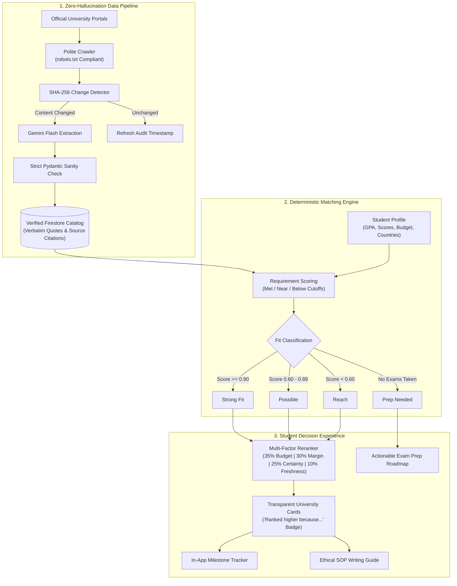

# AbroadPath AI (CareerGoals.ai)

> **Live Application**: [https://careergoals-296e4.web.app](https://careergoals-296e4.web.app)

AbroadPath AI is an intelligent, ethical, zero-hallucination study-abroad decision and application platform. Designed for students targeting international master's programs, the platform combines deterministic client-side matching, verified source provenance, automated milestone reminders, an ethical SOP writing coach with an anti-rewrite guarantee, and strict privacy invariants.

---

## Architecture & Decision Flow



---

## Core Pillars & Project Capabilities

### 1. Deterministic Client-Side Match Engine
- **Algorithmic Scoring**: Calculates exact fit scores across verified entrance requirements without LLM variance:
  - `1.0` (Met): Score meets or exceeds required cutoff.
  - `0.5` (Near): Score falls within a narrow near-margin (IELTS within 0.5, TOEFL within 5, GRE within 5, GMAT within 20).
  - `0.0` (Below): Score is below cutoff.
- **Strict Null Exclusion**: Unconfirmed requirements are completely excluded from the scoring denominator. Students are never penalized for missing university information.
- **Four Distinct Fit Tiers**:
  - **Strong Fit** (Score >= 0.90): Student meets or comfortably clears requirements.
  - **Possible** (Score 0.60 - 0.89): Competitive profile with 1-2 near requirements.
  - **Reach** (Score < 0.60): Ambitious stretch institution.
  - **Prep Needed**: Dedicated path for students who have not yet taken exams (`examsTaken: false`), routing directly to test planning.
- **Multi-Factor Secondary Reranker**:
  - `35% Budget Fit`: Rewards programs matching student budget, giving maximum score to tuition-free institutions.
  - `30% Score Margin`: Measures clearance above minimum thresholds.
  - `25% Data Certainty`: Prioritizes institutions with fewer unconfirmed requirements.
  - `10% Data Freshness`: Rewards recently audited institutional criteria.
  - Every card displays a transparent *"Ranked higher because..."* badge detailing the exact ranking factors.

### 2. Zero-Hallucination Data Pipeline
- **Verified University Catalog**: 11 audited master's programs across Germany, Ireland, and the United Kingdom.
- **100% Provenance & Citations**: Every requirement includes the official portal URL, audit date, and verbatim official snippet.
- **Automated Sync Pipeline (`pipeline/sync_pipeline.py`)**:
  - Python 3.11 crawler compliant with `robots.txt`.
  - SHA-256 hash comparison ensures LLM extraction runs only when official content changes.
  - Pydantic schema validation validates score ranges (IELTS 0.0-9.0, TOEFL 0-120, GRE 260-340, GMAT 200-800).
  - Detects rule changes and flags them (`ruleChanged: true`) with previous vs. new values (demonstrated live with TUM's GMAT rule update).
  - Automated weekly execution via GitHub Actions (`.github/workflows/data_pipeline.yml`).

### 3. Country Guides & Regulatory Requirements
- Comprehensive guides for **Germany**, **Ireland**, and the **United Kingdom**.
- Details official documentation, blocked accounts (German *Sperrkonto* €11,904/year, Irish Stamp 2 funds €10,000), APS certificates (India/China/Vietnam), health insurance requirements, and official portals (DAAD, Education in Ireland).

### 4. Application Tracker & Automated Reminders
- Tracks stages across five milestones: *Shortlisted*, *Preparing*, *Applied*, *Accepted*, and *Rejected*.
- Automatically generates in-app reminders at +1, +3, and +7 days post-submission (`appliedAt`), displaying remaining days and actionable checklist items.

### 5. Rejection Next-Step Roadmap
- Converts rejection into an actionable plan with peer-tier alternatives, profile refinement tips, and static cost/loan estimate tables labeled clearly as non-financial estimates.

### 6. Ethical Statement of Purpose (SOP) Coach
- **Anti-Rewrite Guarantee**: Built-in guardrails ensure the system never generates or rewrites student drafts.
- **Analytical Writing Quality Checker**:
  - Specificity and concrete anchor detection (percentages, tool names, course codes, faculty names).
  - Cliché and vague claim detector.
  - Repetition and sentence readability analysis (>35 words flagged).
  - Programme-specific prompts and official statement length requirements.

### 7. Atlas – Verified Study Abroad AI Guide
- Uses the Firebase AI Logic SDK with the Gemini Developer API, so Gemini API keys are not embedded in the web app and no Firebase Cloud Functions are needed.
- Uses the ROR registry to verify institutions that do not match the catalog. External identity/location facts are labeled and are never presented as verified admissions requirements.
- Uses `gemini-3.8-flash` with `gemini-3.5-flash-lite` as a fallback when the primary returns HTTP 404 or remains overloaded after three HTTP 429/503 attempts.
- 500-character input cap; zero student personal data is ever sent to LLMs.

#### Atlas AI Logic setup

In Firebase Console, open **AI Services → AI Logic → Get started**, select **Gemini Developer API** (not Vertex AI), and finish setup for the existing web app. This uses the Gemini Developer API free tier and does not require deploying Cloud Functions.
The Firebase Console's classic reCAPTCHA provider is deprecated. Register the web app with the **Fraud Defense** provider (reCAPTCHA Enterprise), create a score-based Web key, and set that public site key as `VITE_FIREBASE_APPCHECK_SITE_KEY` in the build environment. Add the live site's domain to the key.

```powershell
npm run build
firebase deploy --only hosting
```

For local development with App Check enforcement, register an App Check debug token in Firebase Console. Do not put a Gemini API key in a `VITE_*` variable or the client `.env` file.

---

## Security & Privacy Invariants

- **Zero Student Data Sent to LLMs**: Student profile details, scores, and names are kept client-side or scoped strictly to authenticated Firestore paths.
- **Firestore Security Rules**: User subcollections (`users/{uid}`) enforce authenticated owner-only reads and writes with score boundary validation. The public catalog (`universities`, `countries`) is strictly read-only.
- **One-Click Data Purge**: A "Delete My Data" feature immediately cascades deletion across all user profile, application, and notification records.
- **No Client Secrets**: API keys and service account credentials are kept out of client bundles and git tracking.

---

## Project Structure

```
.
|-- .github/workflows/
|   `-- data_pipeline.yml         # GitHub Actions cron for live data synchronization
|-- pipeline/                     # Python 3.11 Zero-Hallucination Scraper & Sync Engine
|   |-- sync_pipeline.py          # Main sync pipeline orchestrator
|   |-- fetcher.py                # robots.txt compliant page fetcher
|   |-- extractor.py              # SHA-256 content hashing & text extraction
|   |-- llm_client.py             # Gemini Flash extraction client with retry/backoff
|   |-- schema.py                 # Pydantic schema validation & range checks
|   `-- diff_engine.py            # Rule change detection
|-- src/
|   |-- components/               # Navbar, layout, and factual assistant widget
|   |-- pages/                    # 8 core views (Matches, Onboarding, Tracker, etc.)
|   |-- services/                 # Firebase Auth, Firestore sync, fallback engine
|   |-- utils/                    # Deterministic match engine, writing checker
|   `-- data/                     # Seeded verified datasets (universities.json, countries.json)
|-- tests/
|   |-- unit/                     # Unit test suites (match, letter, profile, assistant)
|   |-- firestore_rules_stress.ts # Firestore security rules stress test
|   `-- stress_match_engine.ts    # Match engine volume & edge case tests
`-- package.json
```

---

## Quickstart & Commands

### Prerequisites
- Node.js 18+ (tested on Node v20/v24)
- npm 9+
- Python 3.11+ (optional, for running the data sync pipeline locally)

### Installation
```bash
git clone https://github.com/Aish-transitminds/Career_Goals.ai.git
cd Career_Goals.ai
npm install
```

### Local Development
```bash
npm run dev
```

### Automated Test Suites
```bash
npm test                 # Runs matchEngine, letterHelperRequirements, and onboardingProfile
npm run test:match       # 59 Match engine & reranking unit tests
npm run test:letter      # Statement requirements & anti-rewrite checklist tests
npm run test:profile     # Onboarding profile validation & boundary tests
```

### Production Build
```bash
npm run build
```

---

## Pre-Configured Demo Profiles

The landing page provides instant one-click demo logins to test distinct applicant journeys:

1. **Alex Chen (Standard Profile)**: IELTS 7.5, GRE 320, Target: Germany/Ireland, Budget: €15,000. Demonstrates strong fit calculations, transparent factor breakdowns, and live rule-change alerts.
2. **Jordan Lee (Prep Needed Profile)**: No exams taken yet (`examsTaken: false`). Demonstrates the educational "Prep Needed" path routing and test planning checklist.
3. **Maria Santos (Low Budget Profile)**: Budget: €3,000. Demonstrates budget reranking favoring public tuition-free German universities.
